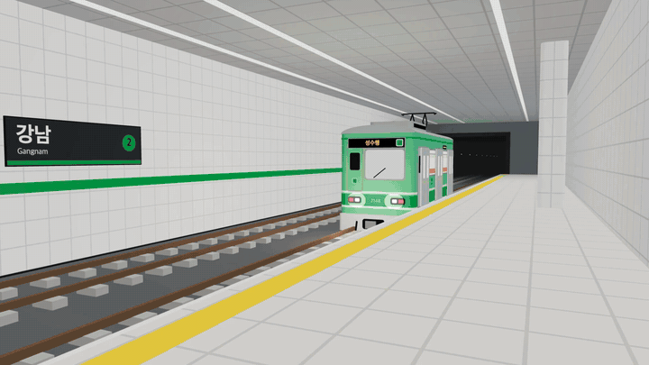
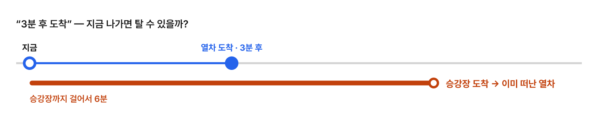
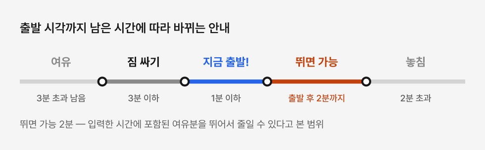
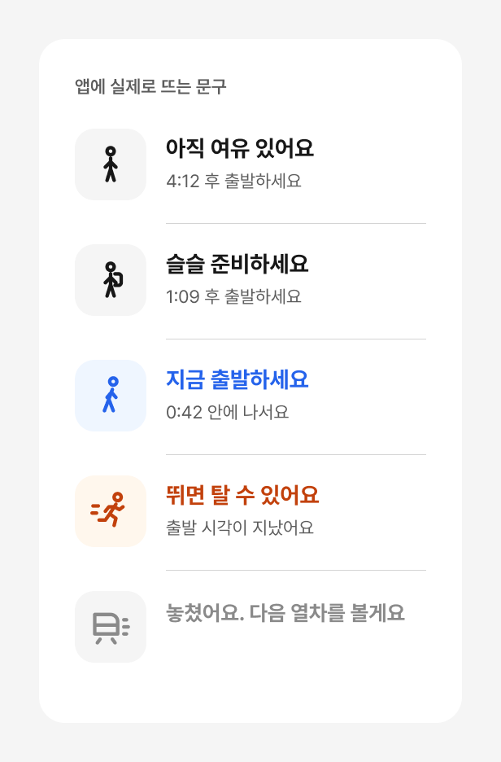
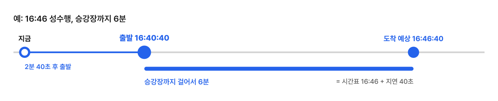
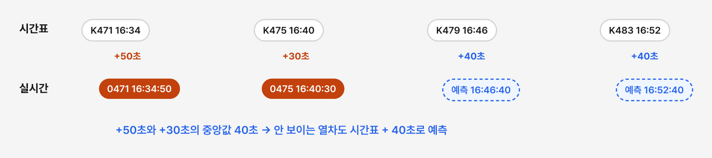
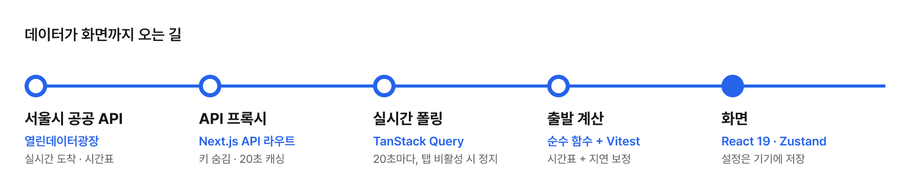
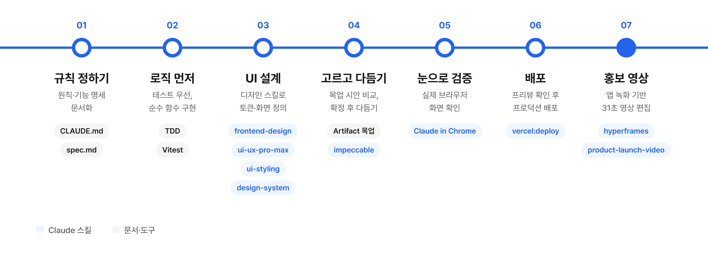

<div align="center">


# LeGo (레고)

**지금 출발하면 탈 수 있을까?**<br/>
"승강장까지 걸리는 시간"만 입력하면 실시간 지하철 도착 정보로 **언제 집을 나서야 하는지** 알려주는 모바일 웹앱입니다.<br/>
다가오는 열차를 3D 선로 위에서 직접 보여줍니다.

[🚇 데모 바로가기](https://lego-jihye.vercel.app/)

</div>

---

## 데모

<div align="center">
  
  <p><a href="docs/lego-promo.mp4">🎬 소개 영상 원본 보기 (MP4, 31초)</a></p>
</div>


## 왜 만들었나

지하철 앱은 "3분 후 도착"이라고만 알려줍니다. 그런데 역까지 6분이 걸린다면 이미 늦은 거죠.
**탈 수 있는지는 결국 사용자가 매번 직접 계산**해야 합니다.



## 어떻게 해결했나

**"승강장까지 걸리는 시간" 하나만** 입력하면, "1분 9초 후 출발하세요"처럼 언제 나가면 되는지 알려줍니다.
출발까지 남은 시간에 따라 안내가 5단계로 바뀝니다.

| 여유 | 짐 싸기 | 지금 출발! | 뛰면 가능 | 놓침 |
|---|---|---|---|---|
| 3분 초과 남음 | 3분 이하 | 1분 이하 | 출발 시각 후 2분까지 | 2분 초과 → 5초 뒤 다음 열차 |

"뛰면 가능 2분"은 입력한 시간에 포함된 여유분을 뛰어서 줄일 수 있다고 보고 정한 기준입니다.

<p>
  
  
</p>

## 동작 원리

**출발 시각 = 열차 도착 예상 시각 − 승강장까지 걸리는 시간**
예: 16:46 열차가 40초 늦게 와서 16:46:40에 도착하고 승강장까지 6분이면 → **16:40:40 출발**



서울시 공공 데이터의 한계는 이렇게 메웠습니다.

| 한계 | 해결 |
|---|---|
| 실시간 정보가 방면마다 다음 2대까지만 옴 | 시간표를 기준으로 삼고, 보이는 열차의 지연(중앙값)을 안 보이는 열차에도 적용 |
| 데이터가 만들어진 뒤 시차가 있음 | 생성 시각(`recptnDt`) 이후 흐른 시간만큼 남은 시간에서 차감 |
| 시간표와 실시간의 열차번호 형식이 다름 (`K479` / `0479`) | 숫자만 비교해 같은 열차를 찾음 |

이 계산은 화면과 분리된 순수 함수([lib/departure/](lib/departure/), [lib/subway/](lib/subway/))이고, 모든 경우를 Vitest 테스트로 검증합니다.



선택한 노선의 공식 색은 화면과 3D 열차 도장에 함께 적용되고, 색각이상 사용자를 위해 노선 번호 배지를 항상 같이 표시합니다.

## 사용법

1. **역 선택** — 역 이름을 검색합니다. 환승역은 노선 배지가 나란히 표시됩니다.
2. **노선·방향 선택** — 상행/하행(2호선은 내선/외선)을 고릅니다.
3. **승강장까지 걸리는 시간 입력** — 지금 있는 곳에서 승강장까지, 여유 시간을 포함해 분 단위로 입력합니다.
4. **메인 화면 확인**
   - 상단: `N분 M초 후 출발하세요` 카운트다운과 상태 문구 (여유 → 짐 싸기 → 지금 출발! → 뛰면 가능 → 놓침)
   - 중앙: 열차가 다가오고, 정차하고, 떠나는 3D 선로 씬
   - 하단: 다음 열차 목록 (행선지, 도착까지 남은 시간, 급행·막차 표시)
<br/>
설정은 기기에 저장되어 다음에 열면 바로 메인 화면이 나옵니다.<br/>
휴대폰에서 데모 링크를 열고 **홈 화면에 추가**하면 앱처럼 쓸 수 있습니다.

## 설치 및 실행

**요구 사항**: Node.js 20 이상, 서울 열린데이터광장 실시간 지하철 인증키

### 1. API 인증키 발급

1. [서울 열린데이터광장](https://data.seoul.go.kr)에 회원가입 후 로그인합니다.
2. [인증키 신청 페이지](https://data.seoul.go.kr/together/mypage/actkeyMain.do)에서 **'실시간 지하철 인증키 신청'** 버튼을 눌러 신청합니다.
3. 발급된 키 하나로 실시간 도착 정보와 열차 시간표를 모두 조회합니다.

### 2. 설치 및 실행

```bash
git clone https://github.com/Jihye-kr/lego.git
cd lego
npm install

# API 키 설정 (서버에서만 사용, 클라이언트에 노출되지 않음)
echo "SEOUL_SUBWAY_API_KEY=발급받은_키" > .env.local

npm run dev        # http://localhost:3000
```

배포할 때는 Vercel 프로젝트의 **Settings → Environment Variables**에 `SEOUL_SUBWAY_API_KEY`를 같은 값으로 추가한 뒤 다시 배포합니다.

| 명령어 | 설명 |
|---|---|
| `npm run dev` | 개발 서버 실행 |
| `npm run build` / `npm start` | 프로덕션 빌드 / 실행 |
| `npm run test` | 단위 테스트 (Vitest) |
| `npm run lint` | 린트 (ESLint) |

## 기술 스택

| 영역 | 사용 기술 |
|---|---|
| 프레임워크 | Next.js 16 (App Router), React 19, TypeScript (strict) |
| 스타일 / UI | Tailwind CSS 4, shadcn/ui (Base UI), lucide-react, Pretendard |
| 상태 관리 | TanStack Query (실시간 폴링), Zustand (persist로 설정 저장) |
| 3D | three.js, @react-three/fiber — 외부 모델 없이 코드로 만든 도형과 캔버스 텍스처로 열차·역사 구현 |
| 데이터 | 서울시 지하철 실시간 도착 API + 시간표 API (서버 프록시, 짧은 캐싱) |
| 테스트 | Vitest (출발 시각 계산·시간 보정 등 순수 함수) |
| 배포 | Vercel, PWA (Web App Manifest) |

데이터 흐름: 서울시 공공 API → Next.js 서버 라우트(API 키 숨김, 20초 캐싱) → TanStack Query 20초 폴링(탭 비활성 시 정지) → 출발 계산 → 화면



## Claude로 만든 과정

[Claude Code](https://claude.com/claude-code)의 스킬을 단계마다 골라 쓰며 만들었습니다.

| 단계 | 사용한 것 |
|---|---|
| 1. 규칙 정하기 | [CLAUDE.md](CLAUDE.md)(코드·색상·API 규칙), [spec.md](spec.md)(기능 명세) |
| 2. 로직 먼저 | 테스트를 먼저 쓰고 순수 함수로 구현 (Vitest) |
| 3. UI 설계 | frontend-design, ui-ux-pro-max, ui-styling, design-system |
| 4. 고르고 다듬기 | Artifact 목업에서 시안 비교 → impeccable로 다듬기 |
| 5. 눈으로 검증 | Claude in Chrome으로 실제 화면 확인 |
| 6. 배포 | vercel:deploy |
| 7. 홍보 영상 | hyperframes, product-launch-video |



만들면서 지킨 원칙은 세 가지입니다.

- **규칙 먼저** — CLAUDE.md에 원칙을 적어 두면 대화가 바뀌어도 같은 기준에서 출발합니다.
- **보고 고르기** — 코드 전에 목업으로 시안을 비교하고, 고른 것만 구현합니다.
- **결정은 기억으로** — 확정한 결정은 메모리에 저장해 같은 질문을 반복하지 않습니다.

## 알려진 제한

- 서울시 구간 밖의 역은 실시간 정보가 제공되지 않습니다.
- 시간표는 1~9호선만 제공되어, 신분당선·공항철도·경의중앙선 등은 실시간 정보(다음 2대)만으로 안내합니다.
- 오프라인 지원(서비스 워커)은 아직 없습니다.

## 데이터 출처

- [서울 열린데이터광장](https://data.seoul.go.kr) — 서울시 지하철 실시간 도착정보, 역별 열차 시간표

## 폴더 구조

```
app/api/        서울시 API 프록시 (arrivals, timetable)
lib/subway/     API 호출·응답 파싱·시간 보정
lib/departure/  출발 시각 계산
lib/lines/      노선 메타데이터 (이름·공식 색상)
components/scene/  3D 선로 씬 (R3F)
```
